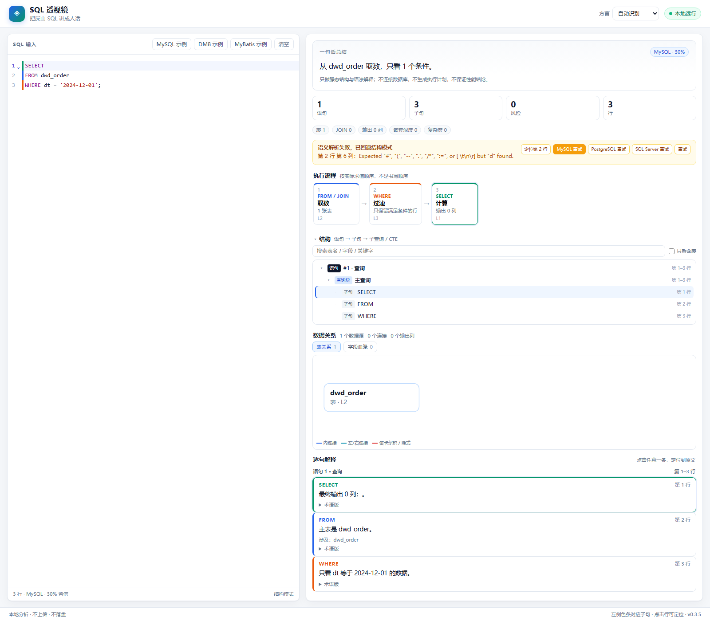
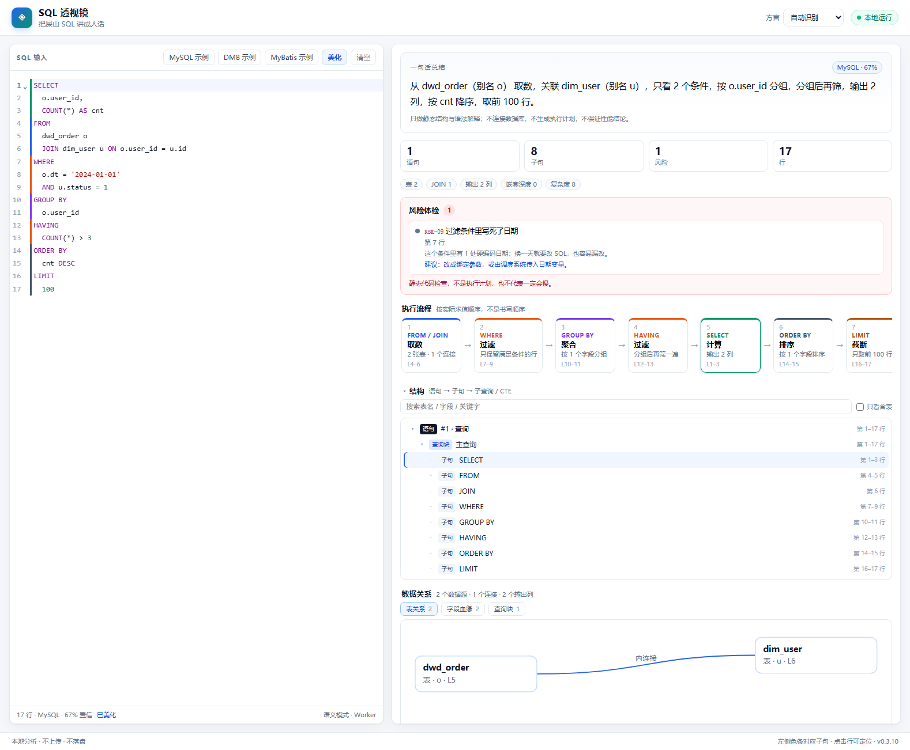
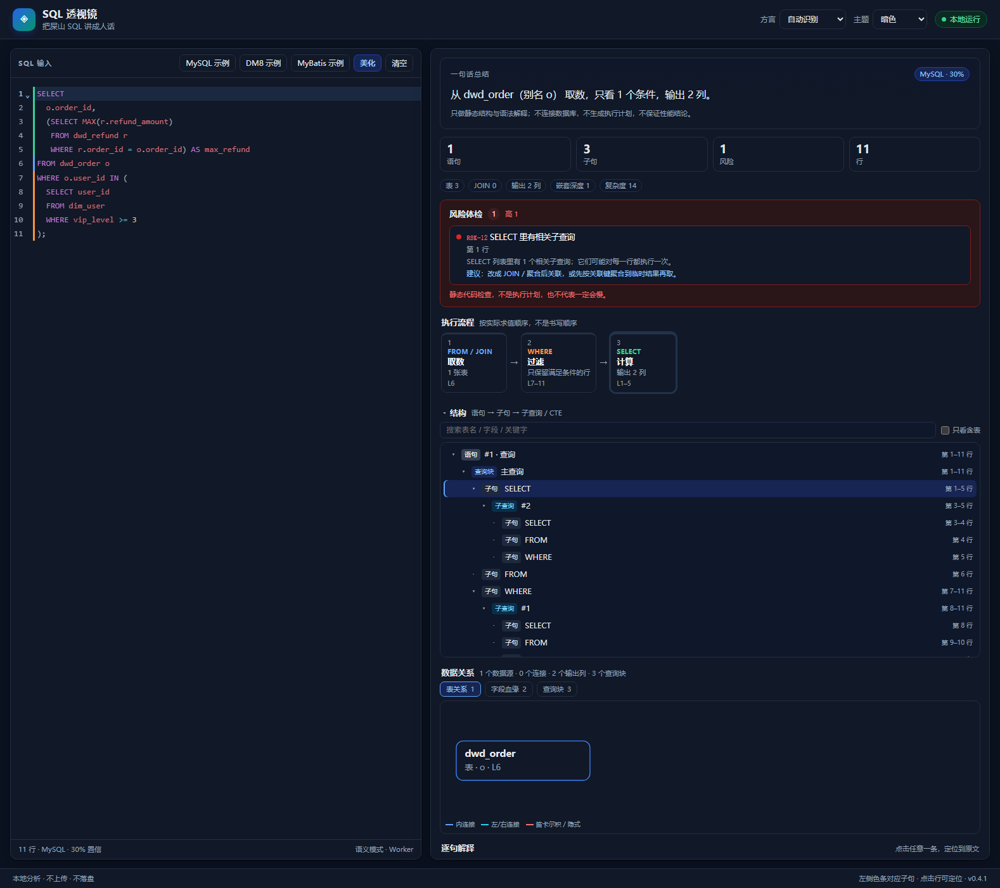

# SQL 透视镜 · sql-xray

把一坨几百行的「屎山 SQL」，变成看得懂的结构 + 说人话的解释。

**纯浏览器运行 · 不上传 · 不入库 · 不留痕 · MIT 开源**

[在线演示](https://yogurt5122.github.io/sql-xray/) · [问题反馈](https://github.com/Yogurt5122/sql-xray/issues) · [源码](https://github.com/Yogurt5122/sql-xray)


> 当前 **0.4.2**：PWA / 离线完成；manifest、Service Worker 预缓存、安装、断网刷新、更新提示；规则 17/17，导出后置。
> 下一步：完整 17 条规则回归；导出后置到最后。

---

## 目录

1. [为什么做](#1-为什么做)
2. [三条原则](#2-三条原则)
3. [现在能做什么](#3-现在能做什么)
4. [支持的方言](#4-支持的方言)
5. [快速开始](#5-快速开始)
6. [隐私](#6-隐私)
7. [设计](#7-设计)
8. [路线图](#8-路线图)
9. [决策记录](#9-决策记录)
10. [目录结构](#10-目录结构)
11. [部署](#11-部署)
12. [安全](#12-安全)
13. [License](#13-license)

---

## 1. 为什么做

接手别人的项目，最劝退的往往不是业务复杂，而是一坨几百行、没人敢改的 SQL：

- 一行一行读，读到最后忘了开头在干什么；
- 子查询套子查询，`t1`、`t2`、`a`、`b` 满天飞，不知道哪个字段从哪来；
- 想跑一下看结果？生产库没权限，测试库数据不对，跑一遍还要等；
- 丢给 AI？公司合规第一条就是「禁止把代码和 SQL 贴到外部网站」。

现有工具各有短板：在线格式化站点要先上传；IDE 插件只高亮不解释；`EXPLAIN` 要库权限；通用 AI 不敢贴。

所以做一个**打开就能用、关掉就没了、全程不联网**的单页工具。

## 2. 三条原则

1. **本地优先**
   解析、分析、解释、绘图全部在浏览器完成。服务器只发一次静态文件，没有接口可调，没有地方可写。
2. **零 SQL 持久化**
   SQL 只存在于页面内存。刷新即清空，关标签页即消失。不写 IndexedDB / Cookie；`localStorage` 只存主题偏好，Service Worker 只缓存静态产物，不缓存 SQL。
3. **渐进降级**
   屎山 SQL 语法千奇百怪，严格解析器一定会失败。**解析失败也必须有用**：退化成「结构模式」，照样能分句、定位、看表、查风险。

## 3. 现在能做什么

### 已实现

| 能力 | 说明 |
| --- | --- |
| 四方言识别 | MySQL / SQL Server / PostgreSQL / DM8，按特征打分，可手动切换 |
| 语义解析 | MySQL / PostgreSQL / SQL Server 走 AST；解析失败自动回退结构模式，并提示出错行号 |
| 错误 UX | 失败横幅显示行 / 列 / 原因，可定位出错行、换 MySQL / PostgreSQL / SQL Server 或强制重试 |
| MyBatis 容错 | 识别 8 个常用标签，等长替换保行号，支持「全保留 / 全去掉」两个变体；`#{}` 转占位符 |
| Web Worker | 解析在 Worker 中执行，260 ms 防抖、可取消；Worker 失败自动回主线程兜底 |
| 语句与子句切分 | 顶层 `;` 切语句；`SELECT / FROM / JOIN / WHERE / GROUP BY / HAVING / ORDER BY / LIMIT` 等切子句；字符串、注释、括号内的关键字不误切 |
| 子句色条 | 编辑器左侧按语义上色，结构在文本里就能看见 |
| SQL 美化 | 本地 `sql-formatter`：关键字大写、2 空格缩进、保留注释；支持四方言；MyBatis XML 跳过；快捷键 `Shift+Alt+F` |
| 暗色模式 | 跟随系统 / 亮 / 暗三档；颜色 token + CodeMirror oneDark；SVG、表格、风险卡、MyBatis 提示全适配；只存主题偏好 |
| 性能 | parser 不进主包，首屏走 Worker；formatter 按需加载；10k 行中位数约 1.8 s |
| PWA / 离线 | manifest + Service Worker 预缓存；可安装、断网刷新、更新提示；只缓存静态产物，不缓存 SQL |
| 执行流程 | 按 `FROM → WHERE → GROUP BY → HAVING → SELECT → ORDER BY → LIMIT` 的真实求值顺序展示，点击阶段定位原文 |
| 结构树 | 语句 → 主查询 → 子句 → 子查询 / CTE / UNION 分支；FROM / WHERE / HAVING / SELECT 子查询都按所在子句展开，可折叠、搜索、只看含表，点击定位 |
| 数据关系 | 表关系图 + 字段血缘 + 查询块；CTE 血缘递归到物理表并显示经过路径，查询块用 SVG 图 + 列表展示主查询 / CTE / 子查询 / UNION 分支 |
| 多语句 | 结果区顶部「语句 1 / 语句 2」切换；总结、数据关系和指标条跟随当前语句，结构树 / 流程 / 解释仍展示全文 |
| 结构指标 | 表数、JOIN 数、输出列数、嵌套深度、复杂度；嵌套深度改用 QueryBlock 计算 |
| 逐句人话解释 | 每个子句一段大白话 + 术语版 + 涉及的表 |
| 一句话总结 | AST 驱动：解析 CTE 底层表、取数来源、过滤条件、分组、输出列、排序与限条 |
| 风险提示 | 已接入 17 条：结构 / 性能 / 语义 / DM8 四类；规则注册表 + 置信度 + 去重 + QueryBlock 上下文 |
| 双向定位 | 点行 → 高亮对应解释；点解释 → 滚动到原文行 |
| 隐私自证 | 构建产物扫描：无 `fetch` / XHR / WebSocket / 外链 |
| 真实语料 | 39 条脱敏 SQL，覆盖四方言、CTE、窗口、多语句、MyBatis、坏 SQL、规则正反例 |
| 性能基准 | 2000 行单查询中位数约 104 ms；`pnpm bench` 可复现 |
| 测试 | 145 个测试：106 个单元测试 + 39 条真实语料 |
### 解析失败时



横幅会给出出错行、列和解析器原因；「定位」跳到出错行，MySQL / PostgreSQL / SQL Server 三个按钮直接换方言重试，最后的「重试」保留当前方言强制重跑。

### SQL 美化



点编辑栏「美化」或按 `Shift+Alt+F`：关键字大写、2 空格缩进、保留注释，改写后的 SQL 会重新走一遍完整分析。MyBatis 动态 SQL 会跳过并提示，避免把 `<if>` / `<where>` 拆坏。

### 暗色模式



顶栏「主题」支持跟随系统 / 亮 / 暗。只把主题偏好写进 `localStorage`，不写 SQL；CodeMirror、SVG 图、血缘表格、风险卡和子句色条都有独立的暗色配色。

### PWA / 离线

Chrome / Edge 点地址栏的安装图标；iOS Safari 用「分享 → 添加到主屏幕」。首次在线打开会预缓存全部静态产物，之后断网刷新仍能分析。

Service Worker 只缓存 app shell、Worker、JS/CSS、图标和 manifest，不缓存 SQL / 分析结果。新版本发布后页面顶部会出现「新版本已就绪」提示，点「刷新更新」才切换。

### 规划中

| 阶段 | 能力 |
| --- | --- |
| M2 | 语义 AST、总结增强、结构树、MyBatis 容错、Web Worker |
| M3 | 表关系图、字段血缘、17 条风险规则、指标卡、DM8 `(+)` 转连接边 |
| M4 | 大 SQL 性能、PWA、单文件离线版、暗色模式、正式发布 |
| V2 | 两版 SQL 对比、MyBatis 完整分支展开、可选 DDL、AI（BYOK） |

## 4. 支持的方言

| 方言 | 目标版本 | 解析策略 | 状态 |
| --- | --- | --- | --- |
| MySQL | 5.7 / 8.0 | `node-sql-parser` | P0 |
| SQL Server | 2016+（T-SQL） | `node-sql-parser`（TransactSQL） | P0 |
| PostgreSQL | 12+ | `node-sql-parser` | P0 |
| 达梦 DM8 | DM8（Oracle 兼容模式） | 结构模式 + 语法画像；语义解析用可选的 Oracle WASM 适配器 | P0 |

DM8 的语法接近 Oracle：`ROWNUM`、`(+)` 外连接、`NVL`、`DECODE`、`CONNECT BY`、`DUAL`、`MINUS`、`VARCHAR2`。现成 JS 解析器都不覆盖，所以 DM8 先用结构层保底。

Hive / ClickHouse 暂不列入首批。

## 5. 快速开始

要求：Node 22+、pnpm 11+。

```bash
cd app
pnpm install
pnpm dev              # http://localhost:5173
```

| 命令 | 作用 |
| --- | --- |
| `pnpm dev` | 本地开发 |
| `pnpm test` | 145 个测试（106 单元 + 39 语料） |
| `pnpm bench` | 跑性能基准，输出行数 / 中位数 / 最小 / 最大 |
| `pnpm build` | 类型检查 + 生产构建 |
| `pnpm check:privacy` | 扫描构建产物：无网络 API、无外部资源 |
| `pnpm preview` | 预览生产构建 |

在线演示：<https://yogurt5122.github.io/sql-xray/>

### 性能基准

环境：Node v24.21.0 · 13th Gen Intel Core i7-13700HX · Windows。  
命令：`pnpm bench`。每个用例预热 1 次，再跑 5 次取中位数；只测核心 `analyzeSql`，不含浏览器渲染和 Worker 通信。

| 场景 | 实际行数 | 语句数 | 中位数 | 最小 | 最大 |
| --- | --- | --- | --- | --- | --- |
| 单查询 100 行目标 | 98 | 1 | 5.0 ms | 4.0 ms | 6.6 ms |
| 单查询 500 行目标 | 498 | 1 | 16.0 ms | 15.4 ms | 19.4 ms |
| 单查询 1000 行目标 | 998 | 1 | 38.3 ms | 36.7 ms | 39.0 ms |
| 单查询 2000 行目标 | 1998 | 1 | 95.5 ms | 93.4 ms | 102.1 ms |
| 单查询 5000 行目标 | 4998 | 1 | 1246.8 ms | 445.0 ms | 1401.3 ms |
| 单查询 10000 行目标 | 9998 | 1 | 1766.4 ms | 1706.2 ms | 2179.5 ms |
| 多语句 500 行目标 | 434 | 62 | 10.4 ms | 9.2 ms | 16.0 ms |
| 多语句 2000 行目标 | 1750 | 250 | 64.9 ms | 64.8 ms | 66.2 ms |

10k 行目标的中位数是 **1766.4 ms**，低于 2 s；最大一次 2179.5 ms，说明超长 AND 链仍有抖动。5000 行样本同样波动较大，后续需要更稳定的长查询优化。

### 真实语料

`app/tests/corpus/` 下有 **39 条脱敏 SQL**，覆盖：

- MySQL：GMV 聚合、窗口函数、两层 CTE、UNION、CASE、IN 子查询、多表 JOIN、JSON、注释里的分号、派生表、多语句、派生表 `ORDER BY`、`DISTINCT` + JOIN、`UNION` 去重、重复表达式、自连接重复表、3 层嵌套、SELECT 相关子查询、低基数列 JOIN + 聚合、隐式类型转换
- PostgreSQL：DISTINCT ON、FILTER、CTE + INTERVAL、`::` 类型转换、LATERAL
- SQL Server：TOP、CTE、DATEADD、窗口函数、CASE + GROUP BY
- DM8：ROWNUM、`(+)` 左侧 / 右侧、两侧都写 `(+)`、可空侧被过滤
- MyBatis：`<where>` / `<if>` / `#{}`
- 坏 SQL：缺右括号、SELECT 列表为空

`corpus.test.ts` 会逐条检查：模式是否符合预期、行号是否落在原文范围内、语句与子句 span 是否自洽、关系 / 总结数量是否和语句数一致、坏 SQL 是否给出行列、派生表和 CTE 的表数是否正确、规则命中的 ID 是否唯一且已注册。

## 6. 隐私

**你粘贴的 SQL 不会被发送到任何服务器，也不会被保存。**

```text
浏览器
  ├─ 粘贴 SQL
  ├─ 在内存中解析、分析、生成解释
  ├─ 结果只渲染在当前页面
  └─ 关闭页面 → 数据消失

服务器
  └─ 只发送一次 HTML / JS / CSS 静态文件，之后不再参与
```

- 没有后端接口、没有数据库、没有账号系统。
- 没有第三方脚本、统计 SDK、广告、字体 CDN。
- 不使用 Cookie；不把 SQL 或结果写入任何浏览器存储。
- 导出功能（M3）会在本地用 `Blob` 生成，不经过服务器。

### 你可以自己验证

1. DevTools → Network：粘贴并分析 SQL，观察是否出现新请求；
2. Application → Local / Session Storage / IndexedDB：确认没有 SQL；
3. 断网后刷新（已缓存时），功能应当正常；
4. 审查源码，或自行构建后与 Release 的 SHA-256 对比。

### 我们防不住的（诚实说明）

- 浏览器扩展读取页面内容；
- 本机恶意软件、录屏软件、内存取证；
- 粘贴之前，剪贴板已被其他程序读取；
- 浏览器崩溃转储；
- 托管平台（GitHub Pages）记录访问 IP 与时间——这是正常 Web 日志，与 SQL 内容无关。

我们承诺的是**架构上不主动外发、不落盘**，不是「任何手段都无法获取」。

## 7. 设计

### 7.1 数据流

```text
粘贴
  → MyBatis 预处理（仅检测到 XML 标签时）
  → Scanner        词法：字符串 / 注释 / 引号 / 参数 / 括号深度
  → Splitter       语句 + 子句 + 精确行号
  → ParserAdapter  按方言路由，尽力而为，允许失败
  → IR Builder     统一中间表示，所有节点带 Span
  → Analyzer       作用域 / 血缘 / 图 / 指标 / 风险
  → Explainer      模板生成人话
  → 渲染 + 双向定位
```

M2 起整条流水线放进 Web Worker，主线程不阻塞。

### 7.2 为什么是分层解析，而不是一个解析器

| 层 | 输入 | 输出 | 失败时 |
| --- | --- | --- | --- |
| L0 Scanner | 原始文本 | Token（offset / 行号 / 括号深度） | 几乎不失败 |
| L1 Splitter | Token | 语句树 + 子句段 | 不失败 |
| L2 Parser | 文本 + 方言 | 第三方 AST | **允许失败** |
| L3 IR | Token + 子句 + AST | `AnalysisResult` | 无 AST 时构建结构版 IR |

这四层是**能力叠加**，不是流水线依赖：L0 / L1 永远可用，L2 / L3 尽力而为。这是「解析失败也有用」的技术基础，也是行号能精确到字符的前提。

### 7.3 DM8 怎么支持

不追求完整 AST，用**语法画像 + 结构规则**拿到最有用的信息：

| 特性 | 处理 |
| --- | --- |
| `(+)` 外连接 | 在 `WHERE` 中识别可空侧，M3 转成 LEFT / RIGHT 连接边 |
| `ROWNUM` | `ROWNUM <= n` 等价 `LIMIT n`；与同层 `ORDER BY` 共存时提示 RSK-16 |
| 分页嵌套 | 还原「排序 → 编号 → 截取」三步 |
| `CONNECT BY` | 标记层级查询，血缘暂停并标注 |
| `NVL` / `DECODE` | 解释为「为空取默认值」/「多分支取值」 |
| `MINUS` / `DUAL` | 集合运算 / 不生成真实数据源 |

边界：`BEGIN ... END` 的 PL/SQL 块整体视为不透明语句，不解析内部流程。

### 7.4 MyBatis

用户从 XML 复制出来的往往不是纯 SQL，而是带 `<if>`、`<where>`、`<foreach>` 的模板。

**做法：等长替换，保住行号。**

```text
原始:   <if test="status != null"> AND status = #{status} </if>
处理后:                            AND status = #{status}
```

标签被替换成等长空格，`offset` 和行号完全不变，双向定位不需要映射表。

- 识别 8 个常用标签：`<if> / <choose> / <when> / <otherwise> / <where> / <set> / <trim> / <foreach> / <include>`；
- 提供「全保留 / 全去掉」两个变体，只做两个极端，不枚举组合；
- 标注「动态条件」，不把 `<if>` 内容说成必然生效；
- 完整分支展开放 V2。

### 7.5 人话怎么生成

**不用 LLM**：零外发、可复现、不编造。

硬规则：

1. 数字必须来自 IR，不能出现原文没有的行数 / 表数 / 列数；
2. 表名、列名、别名必须回查原文，找不到就写「未识别」；
3. 不确定就标注「未识别」「可能是」，并说明依据；
4. 参数 `?` / `:name` / `#{...}` 一律表述为「外部传入的值」，不编造具体取值；
5. 原文注释保留，挂在对应子句上——老 SQL 的注释常是唯一的口径线索。

### 7.6 风险规则

目标 17 条，当前已接入 ✅ 17/17。规则已迁到 `core/rules/` 注册表：统一上下文、严重度 / 类别 / 置信度、同一位置去重；新增规则只需加一个定义文件。RSK-04 / RSK-14 是低置信启发式，UI 会标「启发式」。

- **结构**：✅ `SELECT *`（RSK-01）、✅ 缺连接条件 / 笛卡尔积（RSK-02）、✅ 嵌套过深（RSK-10）
- **性能**：✅ 函数包字段（RSK-03）、✅ 同一大表重复扫描（RSK-05）、✅ 子查询 `ORDER BY` 无 `LIMIT`（RSK-06）、✅ `DISTINCT` 掩盖放大（RSK-07）、✅ `UNION` 可改 `UNION ALL`（RSK-08）、✅ `SELECT` 里的关联子查询（RSK-12）、✅ 1:N JOIN 放大（RSK-14）、✅ 重复计算（RSK-15）
- **语义**：✅ 隐式类型转换（RSK-04）、✅ 硬编码日期（RSK-09）、✅ `NOT IN` 遇 NULL（RSK-11）、✅ `LIMIT` 无 `ORDER BY`（RSK-13）
- **DM8**：✅ `ROWNUM` 与 `ORDER BY` 同层（RSK-16）、✅ `(+)` 放错侧（RSK-17）

所有提示都注明：**静态代码检查，不是执行计划，也不代表一定会慢。**

### 7.7 IR 与稳定 ID

所有视图只读同一份 IR，不直接读 AST，避免「流程图和血缘各说各话」。

节点 ID 用稳定哈希：

```text
id = hash(kind + ':' + startLine + ':' + startCol + ':' + normalize(text)).slice(0, 12)
```

不用随机数。同一段 SQL 多次分析得到相同 ID，V2 的「两版对比」才能对齐节点。

### 7.8 界面

- 左：CodeMirror 6 编辑器，子句左侧彩色竖条（取数蓝 / 过滤橙 / 聚合紫 / 计算绿 / 排序灰 / 风险红）。
- 右：一句话总结 → 指标 → 风险 → 执行流程 → 结构 → 逐句解释。
- 点解释跳到行，点行高亮解释。
- 不加载 Web Font、不引 UI 组件库；主包约 201.4 KB gzip，`format` 按需 74 KB，Worker 解析包约 516 KB，CSS 5.8 KB，SW 0.9 KB。

### 7.9 设计规范（实现依据）

**页面**：单页。桌面左右分栏（编辑 42% / 结果 58%）；≤1080px 上下堆叠。结果区自上而下：总结 → 指标 → 风险 → 执行流程 → 结构 → 数据关系 → 逐句解释。

**配色**：

| 用途 | 色值 |
| --- | --- |
| 背景 / 面板 | `#F5F7FA` / `#FFFFFF` |
| 正文 / 次要文字 | `#0F172A` / `#64748B` |
| 边框 | `#E2E8F0` |
| 主色 | `#2563EB` |
| 风险 | `#DC2626` |

子句语义色：取数 `#2563EB`、过滤 `#EA580C`、聚合 `#7C3AED`、计算 `#059669`、排序 `#475569`、风险 `#DC2626`、未知 `#6B7280`。

**字体**：正文 `system-ui, "PingFang SC", "Microsoft YaHei"`；代码 `ui-monospace, Consolas`。不加载 Web Font。

**间距**：4px 基准；卡片圆角 10px、按钮 7–9px；页面内边距 14–20px。

**组件**：Topbar、EditorPane、SummaryCard、MybatisBanner、Metrics、IssueCard、FlowTrack、StructureTree、RelationsView、ClauseList、StatusBar。

**编辑器工具栏**：示例按钮 / 美化 / 清空；美化快捷键 `Shift+Alt+F`，关键字大写、2 空格缩进、保留注释；检测到 MyBatis 动态 SQL 时跳过并提示。

**暗色模式**：顶栏「主题」选择跟随系统 / 亮 / 暗；`data-theme` 驱动 CSS token，CodeMirror 用 oneDark + 自定义暗色高亮；SVG、表格、风险卡、编辑器子句色条单独适配。只把 `sql-xray-theme` 写进 localStorage，不写 SQL。

**结构树**：位于执行流程下方、数据关系上方；默认展开，可折叠；每层缩进 16px；节点 = 类型徽章 + 名称 + 行号；FROM / WHERE / HAVING / SELECT 子查询和 UNION 分支内部子句由 AST 展开；点击节点跳转原文；顶部搜索框 + 「只看含表」开关；当前光标所在节点高亮。

**数据关系**：位于结构树下方、逐句解释上方；三个页签「表关系 / 字段血缘 / 查询块」。表关系用轻量 SVG：节点 = 表 / CTE / 子查询，边 = 连接类型与条件；字段血缘用表格：输出列 / 来源 / 变换 / 经过 / 行号，来源会递归穿过 CTE；查询块用 SVG 树 + 列表展示主查询 / CTE / 子查询 / UNION 分支，显示行号、物理表数和连接数。

**多语句**：结果区顶部出现「语句 1 / 语句 2」切换；总结、数据关系和指标条跟随当前语句，结构树 / 执行流程 / 逐句解释仍展示全文。

**语义状态与 MyBatis**：编辑器底部显示「语义模式 / 结构模式」，Worker 返回时追加 `· Worker`；分析中显示阶段文案和「取消」。检测到 MyBatis 标签时，在总结卡下方显示蓝色提示条与「全保留 / 全去掉」切换。

**错误提示**：解析失败时在指标条下方显示黄色横幅，包含出错行 / 列 / 解析器原因；右侧提供「定位」「MySQL / PostgreSQL / SQL Server 重试」「重试」。结构模式结果继续展示，不遮挡主流程。

## 8. 路线图

| 阶段 | 主题 | 内容 | 状态 |
| --- | --- | --- | --- |
| M0 | 设计 | 需求、技术方案、交互、路线图 | ✅ |
| M1 | 最小闭环 | 分句、上色、逐句解释、双向定位 | ✅ v0.1.0 |
| M2 | 看懂 | 语义 AST、总结、结构树、MyBatis 容错、Worker | ✅ 完成 |
| M3 | 看透 | 表关系、血缘、17 条规则、指标、DM8 `(+)` | 规则 17/17；UNION 分支 / CTE 链总结 / 查询块图完成；M3-3 剩 UNION 血缘合并、DML、导出 |
| M4 | 可用 | 性能、PWA、单文件离线、暗色模式、发布 | 进行中（0.4.0 性能、0.4.1 暗色、0.4.2 PWA 完成） |
| V2 | 增强 | 两版对比、完整 MyBatis、DDL、AI（BYOK） | 想法池 |

剩余估算约 **40–50 人日**。当前优先补语义 AST 与 MyBatis 容错，再做完整规则与导出。

## 9. 决策记录

| 决策 | 结论 | 说明 |
| --- | --- | --- |
| 首批方言 | MySQL、SQL Server、PostgreSQL、DM8 | DM8 用 Oracle 兼容语法，单独做画像 |
| MyBatis | M2 做容错，不做完整展开 | 覆盖 80% 场景；组合爆炸留给 V2 |
| WASM | M2 末 1–2 天 PoC，只给 DM8 | 门槛：20 段语料成功率 ≥ 70%、≤ 800 KB、500 行 ≤ 300 ms；不达标不上 |
| 两版对比 | V2 第一个功能 | IR 节点 ID 已按稳定哈希设计 |
| 开源 | MIT | 可审计、可自建 |
| 发布 | GitHub Pages | CI 自动部署；内网可托管 `dist/` |
| 英文 | V1 仅中文 | 文案抽离，后续加不返工 |

## 10. 目录结构

```text
sql-xray/
├─ README.md                 # 本文档
├─ LICENSE                   # MIT
├─ assets/preview.png        # 界面截图
├─ assets/preview-error.png  # 解析失败提示
├─ assets/preview-format.png # SQL 美化
├─ assets/preview-dark.png   # 暗色模式
├─ assets/preview-dark-queryblocks.png # 暗色查询块图
├─ app/
│  ├─ src/
│  │  ├─ core/               # scanner / splitter / 语义模型 / 关系 / 指标
│  │  │  └─ rules/           # 规则注册表 + 17 条规则定义
│  │  ├─ parsers/            # node-sql-parser 适配
│  │  ├─ preprocess/         # MyBatis 预处理
│  │  ├─ hooks/              # useAnalysis / useTheme / usePwa
│  │  ├─ workers/            # 分析 Worker + 消息协议
│  │  └─ ui/                 # 编辑器 / 解释列表 / 主页面
│  ├─ public/                # manifest + PWA 图标
│  ├─ tests/                 # 单元测试
│  │  └─ corpus/             # 39 条脱敏 SQL 语料
│  ├─ benchmark/             # 性能基准
│  ├─ scripts/               # 隐私检查 + Service Worker 生成
│  └─ dist/                  # 构建产物（不提交）
└─ .github/workflows/        # CI + Pages 部署
```

## 11. 部署

**GitHub Pages（推荐）**

推送到 `main` 后，`.github/workflows/deploy.yml` 自动构建并发布。

首次使用：仓库 → Settings → Pages → Source 选择 **GitHub Actions**。

**任意静态服务器**

```bash
cd app
pnpm build
# 把 app/dist/ 整个目录丢给 Nginx / 对象存储 / 内网服务器即可
```

构建会同时生成 `dist/sw.js`，并把 `dist/` 里的静态文件写进预缓存列表。部署时要保留 `sw.js`、`manifest.webmanifest` 和 `icons/`；Service Worker 需要 HTTPS（localhost 例外）。

构建使用相对路径（`base: './'`），放在子目录也能正常加载。

## 12. 安全

- 发现安全问题请**不要**开公开 Issue，使用 GitHub 的 [Private vulnerability reporting](https://github.com/Yogurt5122/sql-xray/security/advisories/new)。
- 关注范围：SQL 被外发、XSS、依赖链投毒、构建产物与源码不一致、解析器崩溃。
- 已知边界见 [隐私](#6-隐私)：浏览器扩展、恶意软件、托管平台访问日志不属于本项目能防护的范围。
- Release 会附构建产物 SHA-256，支持自行构建比对（M4）。

## 13. License

[MIT](LICENSE) © 2026 sql-xray contributors
